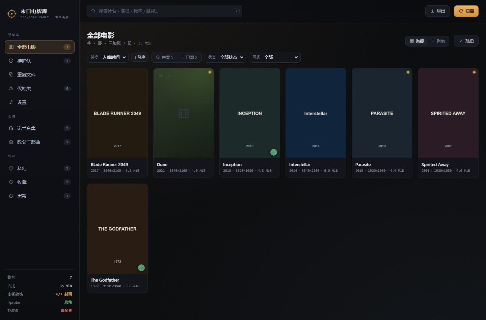
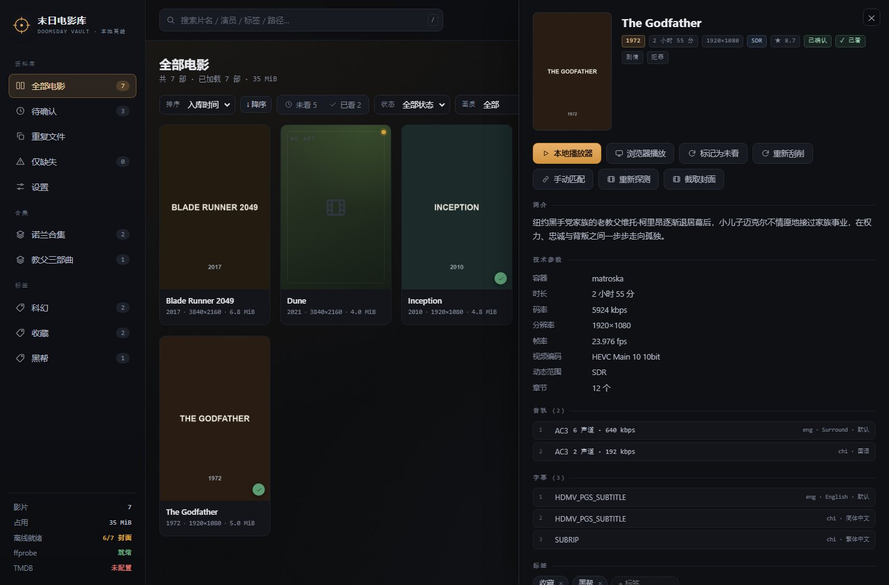
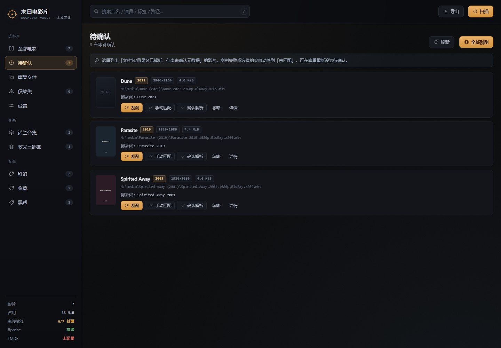
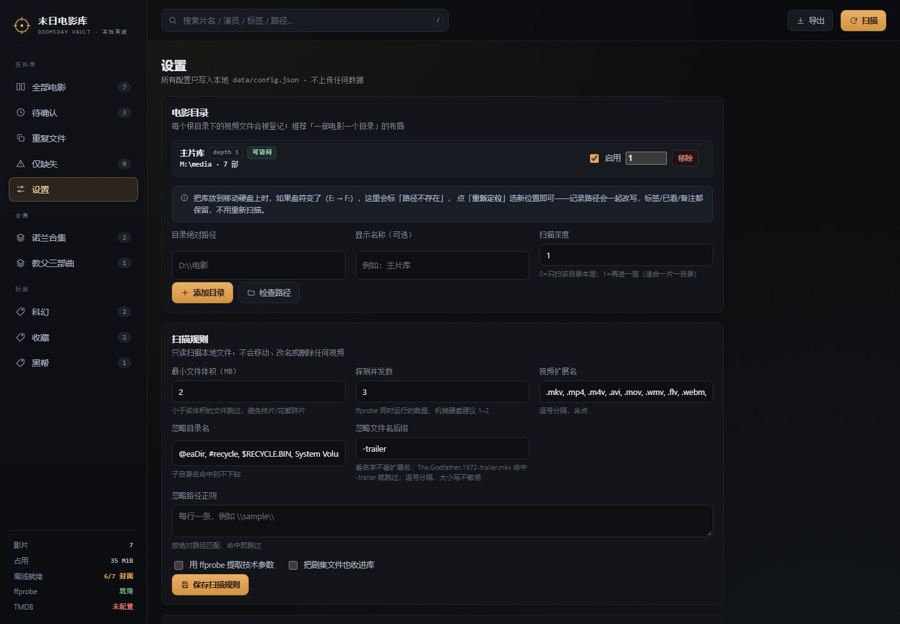

# 末日电影库 · Doomsday Vault

[](LICENSE)


> **Offline-first local movie library.** Scan the video files you already own, read technical metadata with ffprobe, scrape TMDB and cache everything locally — then browse, search and play with zero network. No build step, no npm install, no database.

离线优先的**本地电影管理工具**：扫描你自己硬盘上的视频文件，解析片名、用 ffprobe 读技术参数、向 TMDB 刮削元数据并**缓存到本地**，然后用标签、合集、搜索和待确认队列把它们管起来。断网之后照样能浏览、检索、播放。

> **边界声明**：本项目只处理**你已合法拥有或已获授权**的本地视频文件。它读文件名、读文件元数据、查 TMDB 的公开资料、调用你机器上已装的播放器。
> 它**不包含**影视资源搜索、自动下载、磁力/种子解析、破解或绕过版权保护的任何功能，也**不会**替你下载电影。

---

## 1. 快速开始

要求：**Node.js ≥ 20**。没有 npm 依赖，不需要 `npm install`。

```bash
npm start          # 启动本地服务
# 浏览器打开 http://127.0.0.1:7788
```

Windows 下也可以直接双击 `start.cmd`（会自检 Node、启动服务并自动打开浏览器）。

**启动失败？** 先跑体检，它会逐项指出卡在哪：

```bash
npm run doctor
```

排查清单见 [第 17 节](#17-启动排错troubleshooting)。

首次使用三步：

1. **设置 → 电影目录**：添加你的电影根目录（例如 `D:\电影`），点「检查路径」确认能读到文件；
2. 右上角 **扫描**：登记视频文件、解析片名年份、跑 ffprobe、生成待确认队列；
3. （可选）**设置 → TMDB 元数据** 填入 API Key，再点「全部刮削」，海报和简介就会落盘到本地。

### 三个可选依赖

| 能力 | 不装会怎样 | 怎么装 |
| --- | --- | --- |
| `ffprobe`（FFmpeg） | 仍可扫描、解析、刮削、播放；只是没有时长/分辨率/音轨/字幕信息 | 安装 FFmpeg 并让它进 PATH，或在设置里填 `ffprobe.exe` 的绝对路径（Windows 常见路径会自动探测） |
| `ffmpeg` | **截帧**仍可用「系统缩略图」和「浏览器截帧」两条兜底；只有系统不解码的容器（如 Windows 上的 MKV/HEVC）需要它 | 同上，设置里填 `ffmpeg.exe` 绝对路径后点「重新检测 ffmpeg」 |
| TMDB API Key | 库可正常使用，但没有海报和简介，刮削报「未配置」 | 在 themoviedb.org 免费申请，填入设置；或用环境变量 `TMDB_API_KEY` 启动（此时 Key 不落盘） |

> **便携版 FFmpeg**：把 `ffmpeg.exe` / `ffprobe.exe`（以及同目录的 DLL）放进项目的 `tools/ffmpeg/`，程序会**自动优先识别**，不用改 PATH、不用改配置；删掉这个目录即卸载。`tools/` 已加入 `.gitignore`（约 190MB）。

**Key 用哪一个？** TMDB 的 API 页面上有两个值，**两个都支持**，自动识别：

| 页面上的名称 | 样子 | 本程序怎么用 |
| --- | --- | --- |
| **API 密钥 / API Key**（v3 auth） | `200e8244…337bd3`，32 位十六进制 | 作为 `?api_key=` 查询参数 |
| **API 读访问令牌 / Read Access Token**（v4 auth） | `eyJhbGciOiJIUzI1NiJ9…`，很长的 JWT | 作为 `Authorization: Bearer` 头 |

贴错位置（例如把 v4 令牌贴进 v3 的位置）也不会卡死：收到 401 后会自动换另一种方式重试一次。

---

## 2. 界面预览

> 以下截图来自测试数据：前两部用的是放进电影目录的本地 `poster.jpg`，第三部没有图，显示按片名哈希着色的占位卡（并给出提示条）。未配置 TMDB，所以没有简介和评分。

**电影库**：海报网格 / 列表双视图、筛选条、侧栏按合集与标签聚合



**详情抽屉**：封面、技术参数、音轨字幕、标签合集、备注、播放与刮削入口



**待确认队列**：逐条刮削、手动匹配、确认解析或忽略



**设置**：目录、扫描规则、元数据、播放器、数据维护



---

## 3. 推荐的目录结构（一部电影一个目录）

扫描默认深度是 **1 层**，正好对应「一片一目录」：

```
D:\电影\                                  ← 根目录（depth=1）
├── The Godfather (1972)\
│   └── The.Godfather.1972.1080p.BluRay.x264-SPARKS.mkv
├── 教父2 (1974)\
│   └── movie.mkv                          ← 垃圾文件名也没关系，用目录名解析
├── Inception.2010.1080p.BluRay.mkv        ← 散放在根目录里的文件也会被收录
└── 幕后花絮\                               ← 子目录里的子目录不再下钻
```

每个根目录可以单独设扫描深度：

| depth | 行为 | 适用 |
| --- | --- | --- |
| `0` | 只扫根目录本层的文件 | 平铺布局 |
| `1`（默认） | 根目录 + 每片子目录内的文件 | 一片一目录 |
| `2+` | 继续下钻（最多 99） | 按类型/年份分层的库 |

---

## 4. 功能与实现要点

| 需求 | 实现方式 |
| --- | --- |
| 配置多个电影根目录 | `data/config.json` 的 `roots[]`，每个含路径、别名、启用开关、扫描深度 |
| 扫描视频 | 只读遍历，按扩展名/体积/忽略规则过滤；不移动、不改名、不删除文件 |
| 解析标题与年份 | 文件名 + 目录名双来源；年份限定 `1888..当前年+2`（`Blade Runner 2049` 不会被误判成 2049 年） |
| ffprobe 技术参数 | 时长、分辨率、帧率、位深、HDR、视频/音频编码、音轨语言、字幕轨道、章节数 |
| TMDB 刮削 + 本地缓存 | 搜索→打分选片→详情；JSON 缓存 30 天（可调），海报/背景图下载到 `data/cache/images`，界面只引用本地图片 |
| 本地封面图 | 电影目录里的 `poster.jpg` / `folder.jpg` / `cover.jpg` / `片名-poster.jpg` 直接当封面，`fanart.jpg` / `backdrop.jpg` 当背景图；**不配 TMDB 也有封面**，且本地图优先于在线海报 |
| 重复文件检测 | 先按体积分桶，再算「大小 + 首尾各 4MiB」快速指纹；只出报告，永不自动删 |
| 标签和合集 | 记录级数组字段，支持批量加标签/加合集，侧栏按热度列出 |
| 已看 / 未看 | 详情页手动标记（记录标记时间），批量标记，卡片右下角绿勾，筛选条「未看 N / 已看 M」一键过滤，可按标记时间排序 |
| 搜索筛选 | 片名/原名/简介/演员/导演/路径/标签/合集/备注 全文包含匹配；状态、画质、目录、年份、排序、分页 |
| 详情页 | 右侧抽屉：简介、技术参数、音轨/字幕清单、标签合集编辑、备注、文件路径、元数据来源 |
| 调用本地播放器 | 预设 mpv / VLC / PotPlayer / MPC / IINA / 系统默认，或自定义命令模板；支持续播位置 `{time}` |
| 待确认队列 | 扫描后先进队列，逐条「刮削 / 手动匹配 / 确认 / 忽略」，也可一键批量刮削 |
| 导出 JSON / CSV | 直接下载，或写入 `data/exports/`；CSV 带 UTF-8 BOM（Excel 不乱码） |
| 封面截帧 | TMDB 没封面时从视频抓一帧：先用**系统缩略图**（和资源管理器显示一致），再退 **ffmpeg 截帧**，最后退**浏览器 canvas 截帧** |
| 备份与校验 | 快照含 `config.json` + `library.json` + sha256 清单；校验分浅层（存在/体积）和深度（重算指纹） |

**刮削策略**：标题相似度用 Dice 双字组系数，叠加年份惩罚；低于「最低匹配分」（默认 0.4）的候选不会自动采用，而是留在待确认里等你手动选——避免把《教父2》挂到《教父》上。中文搜不到时自动用兜底语言（默认 `en-US`）再搜一次。

### 封面从哪来？（四级来源，按优先级）

界面上没有封面时显示的是按片名哈希着色的占位卡，不是加载失败。封面来源优先级从高到低：

0. **自定义截帧**（`data/cache/posters/`，详情页「截取封面」生成；可随时取消）
   取图顺序：**系统缩略图 → ffmpeg 截帧 → 浏览器截帧**，详见下一节。

1. **电影目录里的本地图片**（不需要 TMDB、不需要联网）
   把图放进和视频同一个文件夹，扫描后立刻生效：

   | 用途 | 认这些文件名 | 扩展名 |
   | --- | --- | --- |
   | 竖版封面 | `poster`、`folder`、`cover`、`front`、`片名-poster`、`片名.poster`、与视频同名的 `片名.jpg` | `.jpg` `.jpeg` `.png` `.webp` `.avif` |
   | 横版背景 | `fanart`、`backdrop`、`background`、`banner`、`art` | 同上 |

   例：`D:\电影\教父 (1972)\poster.jpg`；或 `The.Godfather.1972.1080p.mkv` 旁边放 `The.Godfather.1972.1080p.jpg`。
   只加图不用重扫全库也行——再点一次「扫描」即可，视频文件本身没变也会被识别为「封面变化」。

2. **TMDB 刮削缓存**（需要免费 API Key）
   设置里填 Key → 点「测试连接」确认能通 → 到「待确认」点「全部刮削」，海报会下载到 `data/cache/images`，之后离线可用。

3. 兜底：按片名哈希着色的占位卡（纯 CSS，离线可用）。

### 截帧：资源管理器里那张图是怎么来的？

Windows 并不是「文件里自带封面」，而是调用**缩略图提供器**（解码器 + Shell API）现解一帧给你看，并缓存在缩略图缓存里。所以最省事的做法不是自己解视频，而是直接向系统要这张图：

| 优先级 | 方式 | 依赖 | 适用 |
| --- | --- | --- | --- |
| 1 | **系统缩略图**（`IShellItemImageFactory` / macOS QuickLook） | 无（系统自带） | 资源管理器能出缩略图的文件 |
| 2 | **ffmpeg 截帧** | FFmpeg | 任意容器/编码，包括 Windows 解不了的 MKV/HEVC |
| 3 | **浏览器截帧**（`<video>` + `canvas`） | 浏览器能解码 | MP4/H.264 等 |

- 在详情页点「**截取封面**」会按这个顺序自动尝试；失败会明确告诉你卡在哪一层（`NO_FRAME_SOURCE`）。
- 设置 → **封面截帧** 可以改 ffmpeg 路径、截帧位置（默认视频 20% 处，避开片头黑屏）、封面宽度，还能一键「为缺封面的影片批量截取」。
- Windows 默认**不解 MKV/HEVC 缩略图**（资源管理器里只显示图标），这时第 1 层必然失败——把 FFmpeg 放进 `tools/ffmpeg/`（或设好路径）后第 2 层就能覆盖。

封面来源会显示在详情页的「元数据 → 封面来源」里（本地文件 / TMDB 缓存图 / 无）。

### 海报语言：为什么封面是中文的？

TMDB 为同一部电影准备了**不同语言的本地化海报**，`poster_path` 跟着请求的 `language` 走。默认「跟随元数据语言」，而元数据语言默认是 `zh-CN`，于是《教父》拿到的是中文版封面。

设置 → 元数据 → **海报语言** 可单独选择：

| 选项 | 效果 |
| --- | --- |
| 跟随元数据语言（默认） | 中文元数据配中文版海报 |
| **原语言** | 外语片用原版（通常英文）海报，中文简介照旧 |
| 英语 / 中文 / 日语 / 韩语 | 固定某一种语言的海报 |

改完之后**已有条目需要重新刮削一次**才会换图（点击详情里的「重新刮削」，或再跑一次批量刮削）——程序会在记录里存 `tmdb.posterLanguage`，语言一变就强制重下；「重新刮削」本身也会强制重下图片。也可以直接删掉 `data/cache/images/<tmdbId>-poster.jpg` 再刮。

> 想全部用原版海报：把海报语言设为「原语言」，然后在「待确认」页点「全部刮削」，或逐条点「重新刮削」。

### 网络被污染时怎么办（自动绕过 DNS 劫持）

部分网络会把 `api.themoviedb.org` 的 DNS 劫持到 Facebook/Twitter 的地址段（`2a03:2880:…:face:b00c`、`104.244.x` 之类），典型表现是：**浏览器里 Key 明明有效，本程序却报 `fetch failed`**。

程序内置了绕行策略（`server/net.mjs`），按顺序尝试：

1. 系统 DNS（先过滤明显被污染的地址）；
2. DoH 加密 DNS（`doh.pub`、阿里 DNS）；
3. **同域兄弟域名**：`www.themoviedb.org` 往往能正常解析到 CloudFront，用它解析出的 IP 配上 `api.themoviedb.org` 的 SNI 去访问；
4. 全部失败才报错，并提示检查网络或代理。

解析结果缓存 10 分钟。设置页的「**网络诊断**」会列出：系统 DNS 解析到什么、是否判定为污染、实际用了哪个地址、HTTPS 是否可用。TMDB 的图片 CDN（`image.tmdb.org`）通常不受影响，所以元数据一旦取到，海报就能下载。

---

## 5. 架构：为什么不是「纯静态页」

浏览器打开本地 HTML 有两条硬限制，直接决定了架构：

- 网页无法枚举任意本地目录（File System Access API 需要每次手动授权，且不能后台重扫）；
- 网页不能执行 `ffprobe`、不能调起 `mpv`，也不该持有 TMDB Key（CORS + 明文暴露）。

所以拆成两块，**前端仍然是零构建的静态页面**：

```
┌───────────────────────────┐        ┌────────────────────────────────────┐
│  web/  纯静态前端          │  HTTP  │  server/  零依赖 Node 本地服务      │
│  ES Modules + 原生 DOM     │ <────> │  只做浏览器拿不到的 OS 能力         │
│  无打包、无框架、无 npm     │  JSON  │  静态托管 + REST API + 文件流       │
└───────────────────────────┘        └────────────────────────────────────┘
                                                  │
                                    ┌─────────────┴─────────────┐
                                    │ ffprobe / TMDB / 本地播放器 │
                                    └───────────────────────────┘
```

- 前端就是 `web/` 里的 HTML/CSS/JS，`index.html` 直接引 `js/app.js`（`type="module"`），**没有构建步骤**，改完刷新即可。
- 本地服务同时托管 `web/`，所以只有一个地址、一个端口、没有跨域问题。
- 前端也可以挂到任意静态服务器上，只要在页面里设 `window.__MOVIE_API_BASE__ = 'http://127.0.0.1:7788'` 指向本地 API。

### 模块职责

| 文件 | 职责 |
| --- | --- |
| `server/index.mjs` | HTTP 服务、路由、静态托管、Range 流、刮削编排、任务启动 |
| `server/config.mjs` | 默认配置、深合并、类型净化、根目录归一化、Key 打码 |
| `server/store.mjs` | 电影库内存索引 + 去抖原子落盘（`library.json`） |
| `server/scan.mjs` | 遍历目录、解析入库、标记失踪、进度上报 |
| `server/parse.mjs` | 文件名/目录名解析（纯函数，最重的单测覆盖） |
| `server/probe.mjs` | ffprobe 定位与输出归一化 |
| `server/tmdb.mjs` | TMDB 客户端、候选打分、磁盘缓存、图片缓存 |
| `server/dupes.mjs` | 重复组与「疑似同片」报告 |
| `server/backup.mjs` | 备份快照、CSV/JSON 导出、完整性校验 |
| `server/player.mjs` / `presets.mjs` | 播放器探测、命令模板渲染、进程启动 |
| `server/jobs.mjs` | 后台任务注册表（扫描/刮削/校验/查重共用） |
| `web/js/app.js` | 路由、侧栏、顶栏、任务轮询、全局事件代理 |
| `web/js/views/*.js` | 库、详情、待确认、重复、设置五个视图 |
| `web/js/state.js` | 共享状态 + `data-act` 动作注册表（事件委托，避免满屏监听器） |

前端没有虚拟 DOM：视图用模板字符串渲染，靠 `data-act="xxx"` 事件委托分发动作，状态集中在 `state.js`。

---

## 6. 数据、备份与迁移

```
data/
├── config.json           # 全部配置（含 TMDB Key，注意别公开这个文件）
├── library.json          # 电影库（记录数组 + 版本号）
├── cache/
│   ├── tmdb/*.json       # 搜索/详情响应缓存（默认 30 天）
│   ├── images/*.jpg      # 海报、背景图、手动匹配缩略图
│   └── posters/*         # 自定义截帧封面
├── exports/              # 「写入 data/exports」导出的文件
└── backups/backup-*/      # 快照：config + library + manifest +（默认）整个 cache/
```

### 断网还能用吗？——能，这是设计前提

**结论**：除了「刮削」和「手动匹配搜索」，其余全部功能都不碰外网。浏览器只访问 `127.0.0.1:7788`，页面不加载任何外部字体/图标/图片。

实测证据（无头 Chrome，把 `*.themoviedb.org` 等域全部拉黑后加载页面）：

```
总请求 28 个 · 外部请求 0 个 · 失败 0 个 · JS 异常 0 个
卡片 9 张 · 海报 10 张 · 简介正常 · 技术参数 22 行
```

| 断网后 | 说明 |
| --- | --- |
| ✅ 浏览 / 搜索 / 筛选 / 标签 / 合集 / 已看标记 | 全部走本地 `library.json` |
| ✅ 封面与背景图 | 来自 `data/cache/images`、`data/cache/posters`，或电影目录里的本地图 |
| ✅ 简介 / 评分 / 演员 / 导演 | 已刮削的结果**内嵌在记录里**，不依赖缓存是否过期 |
| ✅ 技术参数（时长/音轨/字幕） | 来自本地 `ffprobe` |
| ✅ 播放、导出、备份、校验、查重 | 纯本地操作 |
| ❌ 首次刮削 / 重新刮削、手动匹配搜索、TMDB 测试与网络诊断 | 这些本来就要联网 |

> 注意：`cache/tmdb` 的 30 天 TTL 只影响「重新刮削时是否复用缓存」，**不影响你已刮削的元数据展示**——那些数据在 `library.json` 里。

界面入口：侧栏底部常显「**离线就绪 6/6 封面**」；设置 → **离线与缓存** → 「检查离线完整性」，会列出缓存文件数/体积，以及还缺元数据或缺封面的片子（`GET /api/offline/status`）。

**备份现在默认连缓存一起打包**（`cache/tmdb` + `cache/images` + `cache/posters`），换机器后即使断网也能立刻看到全部封面和简介；不想要缓存可以传 `includeCache: false`。

**迁移**：把整个 `data/` 目录拷到新机器，视频文件按原路径放好（或改路径后重扫），启动即恢复——标签、合集、备注、续播位置都按记录 id 保留。
**恢复**：把 `backups/backup-xxxx/` 里的 `config.json`、`library.json` 覆盖回 `data/` 即可。
**合并**：设置页「从 JSON 导入」会上插/覆盖同 id 记录，其余保留。

记录 id 由**文件绝对路径**哈希得出，因此移动文件会被视为新片（旧记录转「缺失」）。路径变了就重扫一次，再在库里清理缺失条目。

关键字段（`library.json` 单条记录）：

```jsonc
{
  "id": "m_a1b2c3d4e5f6a7",          // 路径哈希，稳定
  "path": "D:\\电影\\教父 (1972)\\The.Godfather.1972.mkv",
  "folderName": "教父 (1972)",        // 一片一目录时的目录名
  "size": 1234567890, "mtimeMs": 1792243861849,
  "parsed": { "title": "The Godfather", "year": 1972, "resolution": "1080p",
              "edition": "Extended", "videoCodec": "H.264", "titleSource": "file" },
  "probe": { "durationSec": 10500, "video": { "width": 1920, "height": 1080, "hdr": "HDR10" },
             "audio": [{ "codec": "DTS-HD", "channels": 6, "language": "eng" }],
             "subtitles": [{ "codec": "SUBRIP", "language": "chi" }] },
  "tmdb": { "id": 238, "title": "教父", "year": 1972, "posterPath": "/xxx.jpg",
            "genres": ["剧情", "犯罪"], "directors": ["Francis Ford Coppola"], "matchScore": 1 },
  "matchState": "confirmed",         // pending | auto | confirmed | none
  "localArt": { "poster": "poster.jpg", "backdrop": "fanart.jpg" },  // 扫描时拾取的本地图（相对视频目录）
  "tags": ["收藏"], "collections": ["教父三部曲"], "notes": "",
  "resumeSec": 3600, "playCount": 2, "missing": false,
  "watchedAt": "2026-10-18T10:18:05.712Z",   // null = 未看
  "customPoster": { "file": "custom-m_xxx.jpg", "source": "shell", "width": 500, "height": 281 },
  "addedAt": "...", "updatedAt": "...", "lastSeenAt": "..."
}
```

---

## 6.5 放在移动硬盘 / U 盘上跑

**可以，整包搬走即可。** 项目零依赖（`node_modules` 都不需要），数据在项目内的 `data/`，`tools/ffmpeg` 按相对路径自动识别。

实测：把整个项目复制到 `D:\portable\movie` 后启动——

```
health=true  records=6  dataDir=<新路径>/data
ffprobe=ok   <新路径>/tools/ffmpeg/ffprobe.exe
ffmpeg =ok   <新路径>/tools/ffmpeg/ffmpeg.exe
海报接口 200 · 37594 bytes
```

### 唯一的前提

| 要求 | 说明 |
| --- | --- |
| 目标机器有 **Node.js ≥ 20** | 项目本身不需要 `npm install`；没有 Node 就只能在自己机器上跑 |
| 同一个 `data/` 不要被两个实例同时写 | 你的库是「一机一份」，两台机器各拷一份即可 |
| 端口可用 | 7788 被占时 `set PORT=7799 && npm start`，或 `npm start -- --port 7799` |

### 三种情况

1. **项目搬到移动硬盘，电影还在原来的盘** → 什么都不用改，根的绝对路径依然有效。
2. **电影也一起搬到移动硬盘**（最常见）→ 盘符可能变（`E:` → `F:`），此时：
   - 设置 → 电影目录里该根目录会标 **「路径不存在」**；
   - 点 **「重新定位」**，程序会先在其它盘符里找同名目录并给出候选，选定后把**该根目录下所有记录的路径前缀一起改写、id 重算**，标签 / 合集 / 备注 / 已看 / 播放记录 / 封面全部保留，**不需要重新扫描**；
   - 接口：`POST /api/roots/relocate {rootId, newPath}`，辅助接口 `GET /api/roots/suggest`。

   演练结果（便携副本，2 条记录）：

   ```
   重定位: changed=2  "已把 2 条记录的路径从 …\media2 改到 …\media2-moved"
     The Godfather | …\media2-moved\教父 (1972)\…mkv | tags=收藏 watched=true
   重定位后 海报: 200 | 播放流: 206 | 备注: 「重定位后要还在」
   ```

3. **换一台机器** → 拷 `data/`（或 `data/backups/backup-*`，现在默认含封面缓存）过去即可离线恢复。

> 提醒：`data/config.json` 里有 TMDB Key，移动硬盘丢了就等于 Key 泄露，可在 TMDB 后台重置后改填。

---

## 7. HTTP API

所有接口都在 `/api` 下，JSON 进 JSON 出；视频流支持 `Range`（边下边播、拖动进度条）。

| 方法 | 路径 | 说明 |
| --- | --- | --- |
| GET | `/api/health` | 运行状态、ffprobe、TMDB、计数、任务 |
| GET/PUT | `/api/config` | 读配置（Key 打码）/ 局部更新配置 |
| GET/POST | `/api/roots` | 列出 / 添加根目录 |
| POST | `/api/roots/validate` | 校验路径是否存在、本层视频数 |
| PATCH/DELETE | `/api/roots/:id` | 改别名/深度/启用；删除配置（可选清记录） |
| POST | `/api/roots/relocate` | 换盘符/移动位置：改写该根目录下所有记录路径并重算 id，保留标签/已看/备注 |
| GET | `/api/roots/suggest` | 根目录失效时，在其它盘符里找同名目录作为候选 |
| POST | `/api/scan` | 启动扫描任务（可指定单个根目录） |
| GET | `/api/jobs`、`/api/jobs/:id` | 任务列表 / 进度轮询 |
| DELETE | `/api/jobs/:id` | 取消任务 |
| GET | `/api/movies` | 列表：`q/sort/dir/state/resolution/tag/collection/root/missing/watched/limit/offset`（`sort` 支持 `watchedAt`） |
| GET/PATCH/DELETE | `/api/movies/:id` | 详情 / 改标签合集备注状态、`watched: true\|false` / 仅移出库 |
| POST | `/api/movies/bulk` | 批量：`addTag`、`addCollection`、`confirm`、`pending`、`watched`、`unwatched`、`remove` |
| POST | `/api/movies/:id/scrape` | 重新刮削（`force` 忽略缓存） |
| POST | `/api/movies/:id/match` | 手动指定 TMDB id |
| POST | `/api/movies/:id/probe` | 重新跑 ffprobe |
| POST | `/api/movies/:id/open` | 用本地播放器打开（自动带续播点） |
| POST | `/api/movies/:id/reveal` | 在文件管理器里定位 |
| GET | `/api/movies/:id/stream` | 视频流（Range） |
| GET | `/api/movies/:id/poster?kind=poster\|backdrop` | 封面图：本地图优先，其次 TMDB 缓存；都没有时返回 404 `NO_ART` |
| GET | `/api/queue` | 待确认队列 |
| POST | `/api/queue/scrape` | 批量刮削队列 |
| GET | `/api/tmdb/search` | 手动匹配候选（带匹配分） |
| POST | `/api/tmdb/test` | 测试 Key 与网络连通性，返回示例片名、鉴权方式、实际使用的解析策略和耗时 |
| POST | `/api/network/diagnose` | 网络诊断：DNS 解析结果、是否被污染、实际可用地址、HTTPS 状态 |
| GET | `/api/tmdb/image` | 候选缩略图代理（白名单路径 + 本地缓存） |
| POST | `/api/movies/:id/poster/capture` | 截取封面：`{mode?,atSec?,percent?}` 走系统缩略图/ffmpeg；`{dataUrl}` 存浏览器截帧 |
| DELETE | `/api/movies/:id/poster/capture` | 取消自定义封面，回退到本地图 / TMDB |
| POST | `/api/posters/capture-missing` | 任务：为所有缺封面的影片批量截帧 |
| POST | `/api/ffmpeg/detect` | 重新探测 ffmpeg |
| GET/POST | `/api/dupes` | 读上次结果 / 启动检测 |
| GET | `/api/export?format=csv\|json` | 直接下载 |
| POST | `/api/export` | 写入 `data/exports/` |
| POST | `/api/backup`、GET `/api/backups` | 备份 / 备份列表（`includeCache:false` 只备份两个 JSON） |
| GET | `/api/offline/status` | 离线可用性报告：封面/元数据/探测覆盖率、缓存文件数与体积、缺口清单 |
| POST | `/api/verify` | 完整性校验任务（`deep` 重算指纹） |
| POST | `/api/library/import` | 合并导入 JSON |
| GET | `/api/preview-parse` | 解析预览（调规则时很好用） |

---

## 8. 播放器配置

「自动」会按 `mpv → VLC → PotPlayer → MPC` 的顺序在 PATH 里找，找不到就交给系统默认程序。也可以自定义命令模板：

```text
mpv --fullscreen --start={time} {file}
vlc --fullscreen --start-time={time} {file}
PotPlayerMini64 {file} /seek={time}
```

- `{file}`：视频绝对路径
- `{time}`：续播秒数；位置为 0 时**整段参数会被丢弃**（不会传 `--start=0`）

「浏览器播放」用内置 `<video>` 直读 `/api/movies/:id/stream`，进度会自动回写库（下次本地播放器续播）。受浏览器解码限制，MKV/HEVC/DTS 这类通常放不了——看原盘还是用 mpv/VLC。

---

## 9. 扫描与解析细节

- **忽略**：`@eaDir`、`$RECYCLE.BIN`、`System Volume Information`、`.` 开头目录等；可用「忽略目录名」和「忽略路径正则」自行扩展。非视频扩展名、小于最小体积（默认 2MB）的文件直接跳过。
- **忽略文件名后缀**（`scan.ignoreSuffixes`）：拿**去掉扩展名**的文件名做**大小写不敏感**的后缀匹配，命中就不入库。
  设置 → 扫描规则 → 「忽略文件名后缀」填 `-trailer, sample, 预告`（逗号/顿号/分号分隔）。

  | 文件名 | 后缀规则 | 结果 |
  | --- | --- | --- |
  | `The.Godfather.1972-trailer.mkv` | `-trailer` | ✅ 忽略（只看 `The.Godfather.1972-trailer`） |
  | `Inception.2010.sample.mkv` | `.sample` | ✅ 忽略 |
  | `电影预告.mkv` | `预告` | ✅ 忽略（中文后缀同样可以） |
  | `Sample.2019.1080p.mkv` | `.sample` | ❌ 收进库（后缀匹配，不是包含匹配） |
  | 任意 `.mkv` | `mkv` | ❌ 不忽略（扩展名不算文件名的一部分） |

  - 规则只影响**入库**，从不删除或移动磁盘文件；
  - 加上规则后再扫描，**之前误入库的记录会被一并清理**（只删记录），扫描报告里显示 `skippedIgnored`（跳过几个）和 `ignoredRemoved`（清理了几条旧记录）；
  - 去掉规则再扫描，文件会重新入库（标签等用户数据已随之删除，这点和「移出库」一致）。
- **剧集**：`S01E02`、`1x02`、`第3集`、`Season 2` 会被识别为 `kind: "episode"`，默认**不进主库**（避免混进来几百集），可在设置里打开收录。
- **标题来源**：优先文件名；文件名是 `movie.mkv` / `CD1.avi` / `video.mp4` 这类占位词，或文件名没年份而目录名有时，改用目录名。技术字段（画质/编码/来源）始终优先文件名。
- **识别项**：`2160p/1080p/720p`、`BluRay/WEB-DL/HDTV/DVD/REMUX`、`H.264/HEVC/AV1`、`DTS-HD/TrueHD/Atmos/AC3/E-AC3`、`Extended/Unrated/Director's Cut/IMAX/Remastered`、`CD1/Disc2` 分卷、发布组（`-SPARKS`）。
- **幂等**：体积与修改时间都没变、且已有探测结果的记录会被跳过；但用户标签/合集/备注永远保留。

---

## 10. 重复检测与校验

**查重**（只读报告）：

1. 按文件体积分桶，只有同体积的才有比较价值；
2. 每桶算 `sha1(大小 + 首 4MiB + 尾 4MiB)`，同指纹归为一组；
3. 指纹写回记录，第二次检测直接复用，几乎零 IO；
4. 额外给「同片名+同年份但体积不同」的疑似同片提示（可能是不同画质/版本）。

界面只建议保留哪份（最早入库），删不删由你决定。

**校验**：浅层核对「文件还在吗、体积对不对、修改时间变没变」；深度校验额外重算快速指纹，能发现「同名同大小但内容被替换」。同时检查 `config.json` / `library.json` 是否还能解析。

---

## 11. 命令行

不启动网页也能干活（适合做计划任务）：

```bash
node scripts/cli.mjs scan                 # 扫描已配置目录
node scripts/cli.mjs scrape               # 批量刮削待确认（需 TMDB Key）
node scripts/cli.mjs dupes                # 查重
node scripts/cli.mjs export --format csv --out movies.csv
node scripts/cli.mjs backup               # 备份快照
node scripts/cli.mjs verify --deep        # 深度校验
```

服务本身也支持参数（换端口、自动打开浏览器）：

```bash
npm run doctor                            # 启动体检，排查用
node server/index.mjs --port=7799 --open  # 换端口并自动开浏览器
set PORT=7799 && npm start                # 或者用环境变量
```

---

## 12. 测试

```bash
npm test        # 119 项，全部通过
```

覆盖范围：

- `parse.test.mjs`：23 项命名解析（含中文、分卷、剧集、年份陷阱 `Blade Runner 2049`、一片一目录兜底、发布组前缀）
- `config.test.mjs`：默认值、深合并、根目录归一化与去重、深度钳制、Key 打码、幂等
- `scan.test.mjs`：一片一目录/散片/剧集跳过/体积过滤/深度限制、二次扫描幂等、文件变化后保留标签、失踪标记、停用目录、本地封面图拾取与移除、**忽略后缀（大小写不敏感、只作用于文件名不含扩展名、命中不入库并清理旧记录、不动磁盘文件）**
- `relocate.test.mjs`：换盘符时改路径前缀、重算 id、保留标签/已看/备注、path 索引同步、目标已存在时跳过不覆盖
- `art.test.mjs`：本地封面/背景图命名识别（poster/folder/cover、片名专属、同名图）、目录不存在、readdir 缓存、路径还原
- `dupes.test.mjs`：同内容归组、同体积不同内容不误判、指纹复用、疑似同片、忽略缺失
- `backup.test.mjs`：CSV 转义与 BOM、JSON 结构、快照+清单+轮转、缺失/体积/指纹三类问题、**备份默认包含 cache/（海报/刮削缓存/自定义封面）且可关闭**
- `tmdb.test.mjs`：标题归一化、打分、缓存命中、语言回退、**搜索词不含年份**、年份过严自动放宽、海报落盘、图片代理白名单、v3/v4 两种鉴权、401 自动换鉴权重试、**海报语言跟随/原语言/指定语言/通用图回退**（请求层可注入，不联网）
- `net.test.mjs`：污染地址识别、系统 DNS→DoH→同域兄弟域名的回退顺序、解析缓存、全失败兜底
- `thumb.test.mjs`：截帧策略优先级（系统缩略图 > ffmpeg > 浏览器）、按百分比取帧、ffmpeg 失败改 `-map 0:v:0` 重试、数据上传校验与旧扩展名清理、取消封面、参数钳制、JPEG 宽高解析
- `player.test.mjs`：命令切分、`{file}`/`{time}` 渲染、续播阈值、系统默认分支
- `api.test.mjs`：**真启一个服务进程**跑端到端——静态页、根目录校验/去重、扫描任务、列表筛选排序、详情编辑、已看/未看标记与批量取消、按标记时间排序、Range 206、库外路径 403、本地封面字节与 `NO_ART` 404、自定义封面（dataURL 上传/取消/来源标记）、截帧失败返回 409、**离线状态报告（覆盖率/缺口/零外部资源）**、查重、队列、配置合并与 Key 打码、CSV 字节 BOM、备份、校验、404、目录穿越
- `startup.test.mjs`：重复启动会被识别为「已在运行」且以 0 退出、`--port` 参数换端口、`npm run doctor` 在干净环境下体检通过

测试是并行跑的，服务端口用 `net.listen(0)` 现取空闲端口，避免文件之间撞端口。

界面另外用无头浏览器做过多轮交互验证（扫描、搜索、批量选择、标签增删、抽屉、弹窗、备份、本地封面直出、TMDB 封面落盘、移动端布局），依赖本机 Chrome，没有纳入 `npm test`。

---

## 13. 性能与规模

- 单 JSON 文件（`library.json`）存储，10k 条记录读写都在毫秒级；写入去抖 + 临时文件 rename，断电不会写坏。
- 扫描默认 3 个 ffprobe 并发（机械硬盘建议降到 1–2）；已探测且未变化的文件不重复探测。
- 列表分页 60 条、海报 `loading="lazy"`、卡片 `content-visibility: auto`，万级库滚动不卡。
- 查重大文件只读首尾 4MiB；海报离线后列表零网络请求。

## 14. 安全与隐私

- 服务默认只绑定 `127.0.0.1`（`HOST` 可改），不对外网开放。
- 播放/流式/定位接口会校验目标路径**必须位于已配置的根目录内**，库外路径直接 403。
- `/api/config` 不回传明文 TMDB Key；推荐用环境变量 `TMDB_API_KEY` 避免 Key 落盘。
- 无遥测、无上传、无第三方脚本；页面不加载任何外部资源（字体、图标、图片全本地）。

## 15. 已知限制

- 不做转码/推流，浏览器能否播放取决于编码；原盘请用本地播放器。
- TMDB 刮削需要一次联网；之后元数据与海报都离线可用。网络被 DNS 污染时会自动绕过，但整条链路不通时仍需代理。TMDB 数据版权归 TMDB 所有。
- 单用户、单进程；没有登录/权限体系（本地工具，默认信任本机）。
- 文件移动/改名会被当作新片，需要重扫并在库里清理缺失记录。
- 只按扩展名识别视频，极端自定义容器名需要手动加入「视频扩展名」。

---

## 16. 代码地图

```
movie/
├── server/            # 零依赖本地服务（Node ≥ 20）
│   ├── index.mjs      # HTTP 入口、路由、静态托管
│   ├── config.mjs  store.mjs  jobs.mjs
│   ├── scan.mjs    parse.mjs  probe.mjs
│   ├── tmdb.mjs    dupes.mjs  backup.mjs
│   ├── net.mjs        # HTTPS + DNS 绕行（污染时用兄弟域名 IP + 原 SNI）
│   ├── thumb.mjs      # 截帧：系统缩略图 → ffmpeg → 浏览器上传
│   ├── osthumb.mjs    # 系统缩略图（Shell / QuickLook / 缩略图工具）
│   └── player.mjs  presets.mjs  fsx.mjs
├── web/               # 零构建静态前端
│   ├── index.html     # 唯一入口页
│   ├── styles.css     # 全部样式（暗色 + 胶片颗粒）
│   └── js/
│       ├── app.js     # 路由 / 侧栏 / 顶栏 / 任务轮询
│       ├── api.js     # API 客户端
│       ├── state.js   # 共享状态 + 动作注册表
│       ├── util.js    # 转义/格式化/图标/Toast
│       ├── match.js   # 手动匹配弹窗
│       ├── modal.js   # 模态框容器
│       └── views/     # library / detail / queue / dupes / settings
├── scripts/cli.mjs    # 命令行
├── scripts/doctor.mjs # 启动体检
├── tools/ffmpeg/      # 可选：便携版 FFmpeg（不入库，自动识别）
├── tests/             # node:test 测试
├── docs/              # README 用的界面截图
├── start.cmd          # Windows 双击启动
└── package.json       # 无依赖
```

---

## 17. 启动排错（Troubleshooting）

先跑 `npm run doctor`，它会把下面这些点全部检查一遍并打印结论。

### 1）`npm start` 报 `Could not read package.json` / `ENOENT`

不在项目根目录。根目录里必须同时能看到 `package.json`、`server\`、`web\`：

```bash
cd /d D:\电影库
npm start
```

### 2）窗口一闪就没了 / 双击 `start.cmd` 没反应

现在 `start.cmd` 会先检查 Node、缺文件或报错时**停下来等你按回车**。如果还是闪退，说明 Node 没在 PATH 里：重装 Node.js 20+，或在普通命令行窗口里手动运行一次看到具体报错。

> 注意：`start.cmd` 里的提示刻意写成**英文**——cmd 按当前代码页解析批处理文件，写中文会导致脚本被拆成乱码命令。服务本身输出的中文（端口、数据目录、状态）不受影响，脚本开头已经 `chcp 65001`。

### 3）提示 `端口 7788 被别的程序占用了`

- 如果占用者就是本程序：新的启动会直接告诉你「已经在运行了」并退出（不会启动第二个实例去抢写数据文件）。
  → 直接打开 <http://127.0.0.1:7788>；要重启就先关掉原来的窗口。
- 如果确实是别的程序：

```bash
netstat -ano | findstr :7788
taskkill /PID <上面查到的PID> /F
```

或者换端口：`set PORT=7799 && npm start`，然后访问 `http://127.0.0.1:7799`。

### 4）服务起来了，浏览器却显示「连不上本地服务」

- 地址要用手敲的 `http://127.0.0.1:7788`，**不要双击 `web/index.html`**（`file://` 打开没有后端接口，页面会这样提示）。
- 如果换过端口，记得用新端口。
- 公司电脑的代理/安全软件可能拦截 `127.0.0.1`，把本地地址加入白名单，或换个端口试。

### 5）终端里的中文是乱码

Windows 老版控制台代码页不是 UTF-8：

```cmd
chcp 65001
npm start
```

`start.cmd` 已经自动 `chcp 65001`，双击方式不受影响。

### 6）`npm` 不是内部或外部命令 / `node -v` 没反应

Node.js 没装或没进 PATH。装 Node 20+（<https://nodejs.org/>），装完**重开**一个终端窗口。

### 7）启动时提示 `config.json 无法解析`

配置文件坏了（手工改坏、或写入时断电）：

```bash
ren data\config.json data\config.json.bak     # 重启会用默认配置
# 或者从备份恢复最近一份
dir data\backups
copy data\backups\backup-<最新>\config.json data\config.json
```

`library.json` 同理，损坏时从 `data\backups` 里恢复即可，标签和备注都在里面。

### 8）启动成功，但扫描不到片子

- 到「设置 → 电影目录」点「检查路径」，确认目录可读；
- 默认只扫根目录 + 一层子目录（`depth=1`），更深的层级需要调大深度；
- 默认会跳过小于 2MB 的文件（样片/花絮碎片），必要时把阈值调小；
- 根目录如果被停用（`启用` 复选框没勾），扫描会直接跳过它。

### 9）封面只显示 NO ART 占位卡

不是加载失败，是**这个条目还没有封面图**。三种来源任选：

```text
D:\电影\教父 (1972)\
├── The.Godfather.1972.1080p.mkv
└── poster.jpg            ← 放一张竖图，重新扫描就出现在卡片上
```

- **截帧**：详情页点「截取封面」，程序自动按「系统缩略图 → ffmpeg → 浏览器」取一帧。设置里还能一键「为缺封面的影片批量截取」。
- 本地图：`poster.jpg` / `folder.jpg` / `cover.jpg` / `片名-poster.jpg` / 与视频同名的 `xxx.jpg`；背景图用 `fanart.jpg`。**不需要 TMDB**。
- TMDB：设置里填 Key → 点「测试连接」确认有效 → 到「待确认」点「全部刮削」。
- 已经扫描过也没关系，加完图再点一次右上角「扫描」，视频没变也会被识别为「封面变化」并立刻生效。
- 详情页「元数据 → 封面来源」会写清楚这张图来自截帧、本地还是 TMDB。

**为什么 MKV 截不了？** Windows 默认没有 MKV/HEVC 缩略图提供器，资源管理器里也只显示图标，所以「系统缩略图」这层拿不到；浏览器也不解码 HEVC。装 FFmpeg 后走 ffmpeg 截帧即可覆盖（设置 → 封面截帧 → 填路径 → 重新检测）。

> 顺带一提：如果海报文件存在但界面仍显示占位卡，那是旧版本的层叠 bug（占位层盖住了图片），当前版本已修复。

### 10）「测试连接」报 `fetch failed`（但浏览器里 Key 是有效的）

Key 没问题，是**这个网络到 `api.themoviedb.org` 的 DNS 被劫持**了。典型特征：解析结果是 `2a03:2880:…:face:b00c` 或 `104.244.x`（Facebook / Twitter 的地址段），TCP 443 连不上；而 `www.themoviedb.org`、`image.tmdb.org` 反而是通的。

本程序会自动绕过（详见 [第 4 节](#网络被污染时怎么办自动绕过-dns-劫持)）：先滤掉污染地址，再试 DoH，最后用 `www.themoviedb.org` 的 CloudFront IP 配上 `api.themoviedb.org` 的 SNI 直接访问。

排查顺序：

1. 设置页点「**网络诊断**」，看「系统 DNS / 实际使用 / 策略」三行——如果显示 `alias:www.themoviedb.org` 且 HTTPS 可用，说明已经绕过成功，直接点「测试连接」；
2. 如果诊断显示 HTTPS 也不可用，那是整条链路都不通，需要代理或换网络；
3. 想用代理启动：`set HTTPS_PROXY=http://127.0.0.1:7890 && set NODE_USE_ENV_PROXY=1 && npm start`（Node 24 起内置支持读代理环境变量）。

### 11）想看更详细的运行日志

```bash
npm start                 # 启动信息（端口、数据目录、ffprobe、TMDB 状态）
npm run doctor            # 逐项体检
node scripts/cli.mjs scan # 不开网页，直接扫描并打印细节
```
